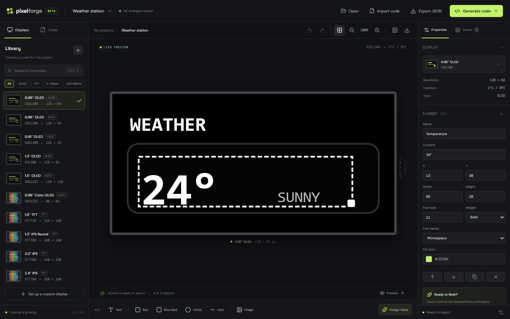
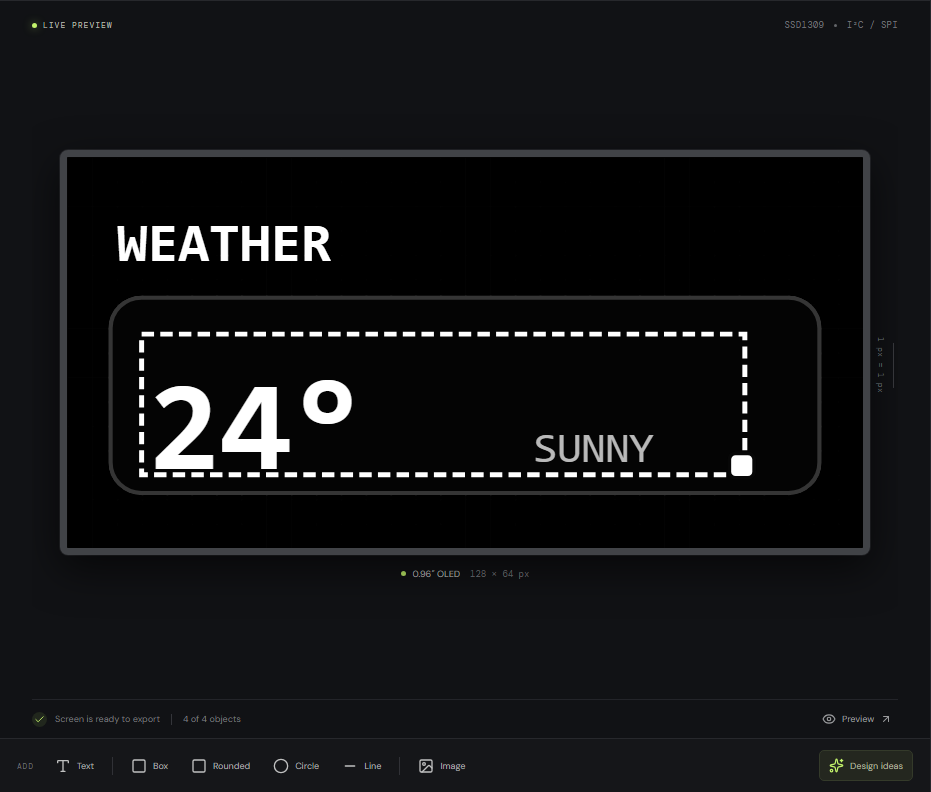

<div align="center">

# PixelForge

### Visual screen editor for Arduino, ESP32 and ESPHome

Design display layouts, import existing code and export graphics or firmware-ready code right in your browser.

**[▶ Try the live demo](https://zerodaylight0.github.io/WEB_DisplayMaker_esp32/)** — no install needed. Accounts and cloud sync are available when you run your own server.

[](https://github.com/ZeroDaylight0/WEB_DisplayMaker_esp32/actions/workflows/ci.yml)
[](https://zerodaylight0.github.io/WEB_DisplayMaker_esp32/)
[](LICENSE)


</div>

---

## Interface



<p align="center"><sub>Workspace: display catalog, live screen preview and properties of the selected element.</sub></p>

<details>
<summary>Close-up: editing a layout on the display</summary>



</details>

## Features

| | |
|---|---|
| **Visual editor** | Text, rectangles (including rounded), circles, lines and images. Fill or outline only, layers, undo and redo, grid snapping, arrow-key nudging and zoom. |
| **Source import** | Load Arduino `.ino` / `.cpp` or ESPHome YAML: recognized commands become editable elements. |
| **Export** | Layouts as PNG, SVG and JSON. Starter code for Arduino (U8g2 / Arduino_GFX) and ESPHome, with Cyrillic text support. |
| **Custom displays** | Any resolution from 8 to 2048 px; custom displays are saved in the browser. |
| **Project storage** | Autosave in the browser, plus accounts on your own server to sync projects between devices. |

The importer understands common U8g2, TFT_eSPI, Adafruit_GFX / Arduino_GFX and ESPHome drawing commands. The original file is kept as a whole, and export replaces only the recognized drawing commands. Unrecognized or dynamic code is left untouched and listed in the warnings.

## Quick start

You need **Node.js 22.13 or newer** and npm. Any current LTS release works: 22 or 24.

Storage uses Node.js's built-in `node:sqlite` module, so nothing native is compiled during install: no `gcc`/`make`/`python` and no Visual Studio.

### Linux / macOS

```sh
git clone https://github.com/ZeroDaylight0/WEB_DisplayMaker_esp32.git
cd WEB_DisplayMaker_esp32
./start-linux.sh
```

The script installs dependencies if needed, builds the editor (only when the sources changed) and starts the server on http://localhost:4173.

> If your distribution ships Node.js older than 22.13 (for example `apt install nodejs` on Ubuntu 22.04/24.04), install a recent version with [nvm](https://github.com/nvm-sh/nvm) (`nvm install --lts`) or [NodeSource](https://github.com/nodesource/distributions).

**Autostart on Ubuntu and other systemd distributions.** Run as your own user, **without `sudo`**:

```sh
./install-ubuntu-autostart.sh
```

The script creates a user service `pixelforge.service`. Logs: `journalctl --user -u pixelforge -f`. To keep the service running without logging in (for example on a headless server), enable `sudo loginctl enable-linger $USER`.

### Windows

Run [`start-windows.bat`](./start-windows.bat).

### Docker

```sh
docker compose up -d --build
```

Data lives in the `pixelforge-data` volume. The image needs no `node_modules` at runtime and runs as an unprivileged user.

## Server configuration

| Variable | Default | Purpose |
|---|---|---|
| `PORT` | `4173` (production), `4174` (dev API) | HTTP server port. |
| `HOST` | `127.0.0.1` | Listen address. `0.0.0.0` allows access from the local network. |
| `PIXELFORGE_DATA_DIR` | `./data` | Directory for the SQLite database. |
| `PIXELFORGE_ALLOW_REGISTRATION` | `1` | `0` disables new account registration. Handy once you have created your own account. |
| `PIXELFORGE_TRUST_PROXY` | `0` | `1` when the server runs behind a reverse proxy (nginx, Caddy, Traefik), so `X-Forwarded-*` headers are trusted. |
| `PIXELFORGE_SECURE_COOKIE` | auto | `Secure` cookie flag. By default it is set only over HTTPS, so sign-in also works over `http://<ip>:4173` on a local network. |

Example: local network access with registration disabled:

```sh
HOST=0.0.0.0 PIXELFORGE_ALLOW_REGISTRATION=0 ./start-linux.sh
```

## Development

```sh
npm ci
npm run dev:api   # terminal 1: API on port 4174
npm run dev       # terminal 2: Vite; /api requests are proxied to the API
```

Checks (the same ones GitHub Actions runs on Linux, Windows and macOS):

```sh
npm run check     # build + editor tests + API tests
```

The static demo is built with `STATIC_DEMO=1 npm run build`. It hides accounts and cloud sync, which need the API server, and is deployed to GitHub Pages on every push to `main`.

## Displays and code export

The catalog includes OLED, TFT, e-paper and LED matrices, among them SSD1306, SH1106, SSD1309, SSD1327, ST7735, ST7789, ILI9341, ILI9488, GC9A01 and MAX7219. Board profiles for CYD, TTGO / LILYGO T-Display, T-Embed, T-Deck and M5Stack Core2 are included too.

- **Arduino:** U8g2 for monochrome displays (Cyrillic text via `drawUTF8` and `_t_cyrillic` fonts) and Arduino_GFX for color displays.
- **ESPHome:** templates for SSD1306 / SH1106 / SSD1327, ST7789, ILI9xxx, Waveshare e-paper and MAX7219. Each text size gets its own font; Cyrillic is added through `glyphsets`.

For unsupported combinations PixelForge does not emit placeholder code: layout and image export remain available.

> Generated code is a starting point, not finished firmware for every board. Before flashing, check the controller model, pinout, rotation, offsets and library settings. The GPIO numbers are an ESP32 example. Imported images are kept in the layout and image export but are not converted to bitmaps for firmware.

### Example: inverter power on an ESP32-C3

The [sketch](./examples/esp32c3-ili9341-inverter-power/) for an ESP32-C3 Super Mini and an ILI9341 receives inverter power in watts over MQTT, picks the gauge range automatically and shows the current value in large digits.

1. Copy `secrets.example.h` to `secrets.h` in the same folder.
2. Fill in Wi-Fi, the MQTT broker address, username and password, and the `POWER_TOPIC` topic in `secrets.h`. The topic payload must be a number, for example `1240`.
3. Open `esp32c3-ili9341-inverter-power.ino` in the Arduino IDE and flash the board.

`secrets.h` is listed in `.gitignore`, and CI fails if such a file is committed, so your network passwords never end up on GitHub. To preview the sketch in PixelForge, load the `.ino` with **Import code → Upload file**.

## Data storage and security

- Accounts and projects are stored in SQLite: `data/pixelforge.sqlite`, file mode `0600`. A legacy `data/accounts.json` is imported automatically on first start and kept as a backup.
- Passwords are hashed with salted scrypt; sessions are stored only as hashes. Cookies are `HttpOnly` and `SameSite=Strict`.
- Sign-in attempts are rate limited, state-changing requests are Origin-checked, CSP / X-Frame-Options / nosniff headers are set and path traversal is blocked.
- Changing your password ends all other sessions.
- This is not a hosted cloud service: the data belongs to the server the app runs on. If the server is reachable from the internet, use HTTPS (through a reverse proxy with `PIXELFORGE_TRUST_PROXY=1`) and back up the data directory.

## Keyboard shortcuts

| Action | Windows / Linux | macOS |
|---|---|---|
| Undo / redo | `Ctrl+Z` / `Ctrl+Y` | `Cmd+Z` / `Cmd+Shift+Z` |
| Copy / paste / duplicate element | `Ctrl+C` / `Ctrl+V` / `Ctrl+D` | `Cmd+C` / `Cmd+V` / `Cmd+D` |
| Nudge element by 1 / 10 px | `←↑→↓` / `Shift+←↑→↓` | same |
| Delete element | `Delete` / `Backspace` | same |
| Deselect / close dialog | `Esc` | `Esc` |
| Search displays | `Ctrl+K` | `Cmd+K` |
| Zoom canvas | `Ctrl` + mouse wheel | `Cmd` + mouse wheel |

Input fields keep their standard key behavior.

## License

[MIT](LICENSE) © 2026 ZeroDaylight0
