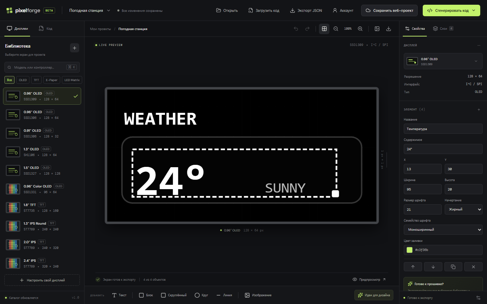
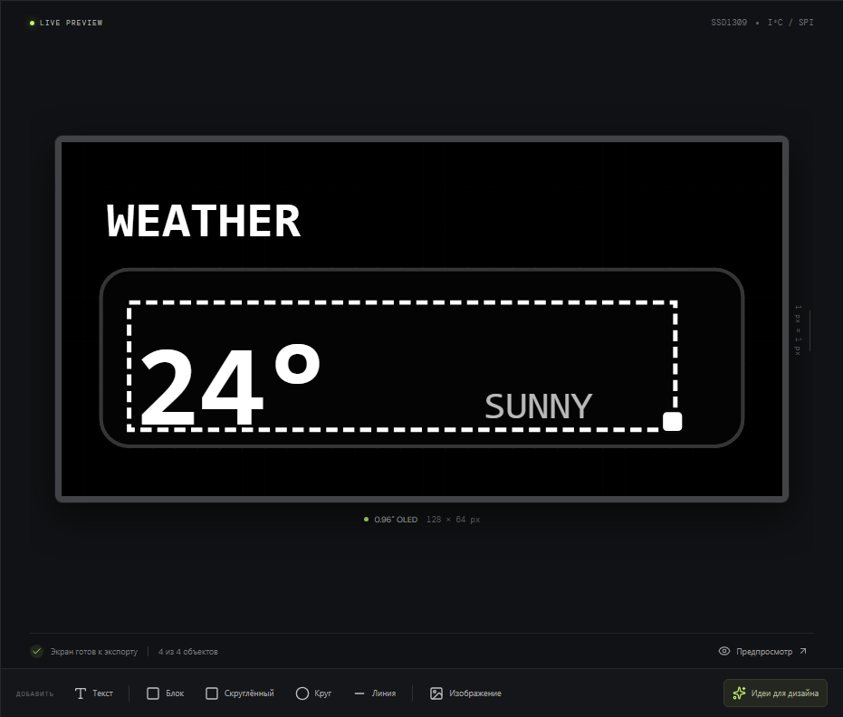

<div align="center">

# PixelForge

### Визуальный редактор экранов для Arduino, ESP32 и ESPHome

Создавайте макеты дисплеев, импортируйте существующий код и экспортируйте графику или заготовки прошивки — прямо в браузере.

[](https://github.com/ZeroDaylight0/WEB_DisplayMaker_esp32/actions/workflows/ci.yml)


</div>

---

## Интерфейс



<p align="center"><sub>Рабочее пространство: каталог дисплеев, предпросмотр экрана и редактирование выбранного элемента.</sub></p>

<details>
<summary>Крупнее: редактирование макета на дисплее</summary>



</details>

## Возможности

| | |
|---|---|
| **Визуальный редактор** | Текст, фигуры, линии, слои, отмена и повтор действий, масштабирование и настраиваемые размеры дисплея. |
| **Импорт исходников** | Загрузка Arduino `.ino` / `.cpp` и ESPHome YAML; распознанные команды становятся редактируемыми элементами. |
| **Экспорт** | Макеты в PNG, SVG и JSON; заготовки кода для Arduino и конфигурации ESPHome для поддерживаемых дисплеев. |
| **Сохранение проектов** | Автосохранение в браузере и учётные записи локального сервера для сохранения и синхронизации проектов. |

Импортёр работает с распространёнными командами рисования U8g2, TFT_eSPI, Adafruit_GFX / Arduino_GFX и ESPHome. Он сохраняет исходный файл и при экспорте меняет только распознанные команды отрисовки. Нераспознанный или динамический код остаётся нетронутым и показывается в предупреждениях.

## Быстрый запуск

Требуется **Node.js 20 или новее** и npm. Node.js 20 и 22 — рекомендуемые поддерживаемые LTS-релизы. Node.js 21.4.0 также проверяется на Ubuntu. У Node 21 нет готового Windows-бинарника для `better-sqlite3`, поэтому на Windows эта версия требует Visual Studio Build Tools с C++; проще использовать Node 20 или 22.

```sh
git clone https://github.com/ZeroDaylight0/WEB_DisplayMaker_esp32.git
cd WEB_DisplayMaker_esp32
npm ci
```

В первом терминале запустите API:

```sh
npm run dev:api
```

Во втором терминале запустите редактор:

```sh
npm run dev
```

Откройте адрес Vite-сервера, который появится в терминале. В режиме разработки Vite перенаправляет запросы `/api` на локальный API-порт `4174`.

### Запуск production-версии

```sh
npm run build
```

Windows: запустите [`start-windows.bat`](./start-windows.bat). Linux: выполните `sh ./start-linux.sh` из каталога проекта.

Чтобы настроить автозапуск на Ubuntu, войдите под пользователем рабочего стола и выполните `sh ./install-ubuntu-autostart.sh` — **без `sudo`**. Скрипт создаст пользовательскую службу systemd.

## Проверки

Те же команды выполняются в GitHub Actions при push и pull request:

```sh
npm run build
npm test
npm run test:server
```

## Дисплеи и экспорт кода

В каталоге есть OLED, TFT, e-paper и LED matrix дисплеи, включая SSD1306, SH1106, SSD1327, ST7735, ST7789, ILI9341, GC9A01 и MAX7219. Также доступны профили CYD, TTGO / LILYGO T-Display, T-Embed, T-Deck и M5Stack Core2. Можно задать собственное разрешение экрана от 8 до 2048 пикселей.

- **Arduino:** генератор использует U8g2 для настроенных монохромных дисплеев и Arduino_GFX для настроенных цветных дисплеев.
- **ESPHome:** шаблоны доступны для настроенных сочетаний контроллера и платформы, включая SSD1306 / SH1106 / SSD1327, ST7789, ILI9xxx, Waveshare e-paper и MAX7219.

Для неподдерживаемого сочетания PixelForge не подставляет фиктивный код: макет и экспорт изображения остаются доступны.

> Сгенерированный код — заготовка, а не готовая прошивка для любой платы. Перед использованием проверьте модель контроллера, распиновку, ориентацию, смещения и настройки библиотек. Указанные GPIO — примеры для ESP32. Импортированные изображения сохраняются в макете и графическом экспорте, но не преобразуются в bitmap для прошивки.

## Хранение данных

Аккаунты и проекты хранятся локально на сервере в SQLite: `data/pixelforge.sqlite`. При первом запуске старые данные из `data/accounts.json`, если файл есть, автоматически импортируются в SQLite; JSON-файл остаётся резервной копией. Для другого каталога данных задайте переменную `PIXELFORGE_DATA_DIR`.

Аккаунты не являются размещённым облачным сервисом: данные принадлежат экземпляру сервера, на котором запущено приложение. Для production-сервера используйте HTTPS и регулярно создавайте резервные копии. Перед резервным копированием SQLite остановите сервер.

## Горячие клавиши

| Действие | Windows / Linux | macOS |
|---|---|---|
| Отменить / повторить | `Ctrl+Z` / `Ctrl+Y` | `Cmd+Z` / `Cmd+Shift+Z` |
| Копировать / вставить элемент | `Ctrl+C` / `Ctrl+V` | `Cmd+C` / `Cmd+V` |
| Масштабировать холст | `Ctrl` + колёсико мыши | `Cmd` + колёсико мыши |

Поля ввода сохраняют стандартное поведение клавиш для текста и буфера обмена.

## Лицензия

Лицензия проекта пока не указана.
